<div align="center">

<picture>
  <source media="(prefers-color-scheme: dark)" srcset=".github/assets/banner-dark.svg">
  
</picture>

**Voice notes that play, queue and route like a messenger.**<br>
Headless native audio for PAM Native: ExoPlayer and AVQueuePlayer with a native queue, pitch-preserving speed, proximity earpiece routing, pushed progress events and the voice recorder.

[](https://packagist.org/packages/pushinbr/pam-native-audio)
[](https://github.com/push-in/pam-native-audio/releases/latest)

[](LICENSE)

[Install](#install) · [Quick example](#quick-example) · [Platforms](#platform-support) · [Permissions](#requirements) · [Docs](#docs) · [Issues](https://github.com/push-in/pam-native-audio/issues)

</div>

<a id="install"></a>
## <picture></picture> Install

Inside a PAM Native project, add only this capability:

```sh
pam composer require pushinbr/pam-native-audio
pam doctor --fix
```

The package is a PAM Native plugin discovered from Composer; nothing is added to `pam-native.json`. New to PAM? Create a project with `pam init my-app --template native` (see the [PAM Native overview](https://push-in.github.io/pam-docs/native/overview/)), then come back here.

<a id="quick-example"></a>
## <picture></picture> Quick example

```php
<?php

use Pam\Native\Audio\{AudioPlayer, AudioRoute, PlaybackProgress, PlaybackRate, PlaybackState};

$player = AudioPlayer::make('voice/8f1c.m4a')           // sandbox-relative path or https URL
    ->rate(PlaybackRate::X1_5)
    ->route(AudioRoute::Auto)
    ->progressInterval(250)
    ->onProgress(function (PlaybackProgress $p): void { $this->position = $p->positionMillis; })
    ->onStateChange(function (PlaybackState $s): void { $this->playing = $s === PlaybackState::Playing; })
    ->onEnd(function (): void { $this->position = 0; })
    ->onError(function (string $message): void { $this->error = $message; })
    ->play();

AudioPlayer::current()?->seek(12_000);
AudioPlayer::current()?->rate(AudioPlayer::current()->playbackRate()->nextVoiceNoteRate()); // 1x -> 1.5x -> 2x
AudioPlayer::stopAll();
```

Event handlers run on the PHP worker; writing component properties from them re-renders only that component. The queue, auto-advance, the Zé Chat player and every method are in the [playback guide](docs/guide.md) and the [API reference](docs/api-reference.md). A runnable minimal app is in [`example/`](example).

<a id="platform-support"></a>
## <picture></picture> Platform support

| Platform | Support | Notes |
| --- | --- | --- |
| Android | API 26+ | Media3 ExoPlayer, datasource and database 1.10.1; 64 MiB LRU cache in `cacheDir/pam-audio-cache` |
| iOS | 15.0+ | `AVQueuePlayer` + `AVAudioSession` (AVFoundation, CoreMedia); not validated on a device yet |
| PAM Native | 1.46.0 to < 2.0.0 | From `pam-native.plugin.json`; PHP 8.5+ |

<a id="requirements"></a>
## <picture></picture> Permissions and requirements

| Platform | Declared by the plugin |
| --- | --- |
| Android | `android.permission.RECORD_AUDIO` (recorder), `MODIFY_AUDIO_SETTINGS` (communication mode for the earpiece), `WAKE_LOCK` (proximity screen-off); the AAR manifest adds `INTERNET` and `ACCESS_NETWORK_STATE` for remote sources |
| iOS | `NSMicrophoneUsageDescription` ("Record voice messages.") |

Playback needs no runtime permission. The player requests transient audio focus and pauses when focus is lost, on interruptions (a phone call) and when headphones are unplugged. The package does not declare the iOS `audio` background mode, so iOS suspends playback when the app goes to the background unless another plugin (for example `pam-native-calls`) or your host declares it. Full platform notes: [docs/platform-notes.md](docs/platform-notes.md).

<a id="what-you-can-build"></a>
## <picture></picture> What you can build

- **Voice-note bubbles** with play/pause, seek, elapsed time and a 1x, 1.5x, 2x speed toggle.
- **Auto-advance** through consecutive voice notes with a native queue (up to 200 items): the next note starts even if PHP is busy rendering.
- **Ear-to-phone playback**: `AudioRoute::Auto` moves playback to the earpiece (voice stream, screen off) while the phone is at the ear and back to the speaker when it is lowered; wired and Bluetooth headsets are left alone.
- **Cached remote audio**: https sources stream on first play and are kept in a 64 MiB LRU cache.

PHP never polls: the native side pushes compact events.

| | |
| --- | --- |
| **Best for** | Voice notes, podcast snippets, short audio messages, sound previews |
| **Native path** | Media3 ExoPlayer 1.10 on Android · `AVQueuePlayer` + `AVAudioSession` on iOS |
| **Application model** | Composer package + generated native integration (`audio-player` module) |
| **Design rule** | Headless: no UI bundled; your component renders the bubble and waveform |

<a id="voice-recorder"></a>
## <picture></picture> Voice recorder

Moved from the PAM Native core in 1.46 (`Pam\Native\System\AudioRecorder` is a deprecated alias for 1.46 only):

```php
use Pam\Native\Audio\AudioRecorder;
use Pam\Native\Audio\AudioRecording;

AudioRecorder::start(static function (): void {});
AudioRecorder::stop(static function (AudioRecording $recording): void {
    // $recording->relativePath, durationMs, size, mimeType
});
```

<a id="sources"></a>
## <picture></picture> Sources

A source is either an `http(s)://` URL (at most 4096 bytes) or a path **relative to the PAM file sandbox** (at most 1024 bytes, no leading `/`, no `..`, no `\`, no scheme): `filesDir/pam-files` on Android, `Application Support/pam-files` on iOS, the same space as `FileReference::$path`, `AudioRecorder` and `pam-native-media`. A recorder `file://…/pam-files/voice/1.m4a` URI must be reduced to `voice/1.m4a` before playing it.

<a id="compatibility"></a>
## <picture></picture> Compatibility

| `pushinbr/pam-native-audio` | `pushinbr/pam-native` | Android | iOS |
| --- | --- | --- | --- |
| 0.3.x | `>=1.46.0 <2.0.0` (manifest) | API 26+ | 15+ |
| 0.2.x | `>=1.0.35 <2.0.0` (tested with 1.14.x) | API 26+ | 15+ |
| 0.1.x | `>=1.0.35 <2.0.0` | API 26+ | Not supported |

<a id="tests"></a>
## <picture></picture> Tests

```bash
pam tests/run.php
cd android && ../../pam-native/android/gradlew -p . connectedDebugAndroidTest
```

The instrumented suite plays generated WAV files through ExoPlayer: queue auto-advance with progress and end events, pause/resume/seek/rate on the live player, single current player, proximity earpiece routing (voice stream, audio mode, route events) and failure handling. `ios/Tests/AudioPlayerTests.swift` mirrors it with XCTest.

<a id="docs"></a>
## <picture></picture> Docs

- [PAM Native overview](https://push-in.github.io/pam-docs/native/overview/)
- [PAM introduction](https://push-in.github.io/pam-docs/introduction/)
- [Playback guide](docs/guide.md): play, queue, the Zé Chat player, limits and troubleshooting
- [API reference](docs/api-reference.md)
- [Install and platform notes](docs/platform-notes.md)
- [Package docs](https://push-in.github.io/pam-docs/packages/native-audio/)
- [Example app](example/)
- [Changelog](CHANGELOG.md)
- [Report an issue](https://github.com/push-in/pam-native-audio/issues)

<a id="pam-ecosystem"></a>
## <picture></picture> Part of the PAM ecosystem

<p align="center"><picture>
  <source media="(prefers-color-scheme: dark)" srcset=".github/assets/pam-wordmark-dark.svg">
  
</picture></p>

PAM runs PHP natively on servers, desktops and phones. This repository is one piece of it.

| [**PAM**](https://github.com/push-in/pam) | [**PAM Desktop**](https://github.com/push-in/pam-desktop) | [**PAM Native**](https://github.com/push-in/pam-native) | [**Ecosystem**](https://github.com/push-in/pam#ecosystem) |
| --- | --- | --- | --- |
| the runtime and CLI | native desktop apps in PHP | native Android and iOS apps in PHP | every official package and plugin |

<sub>Docs: [push-in.github.io/pam-docs](https://push-in.github.io/pam-docs/introduction/) · [Issues](https://github.com/push-in/pam-native-audio/issues)</sub>

<p align="center"><sub><a href="LICENSE">Apache License 2.0</a> · Made in Brazil by Pushin</sub></p>
